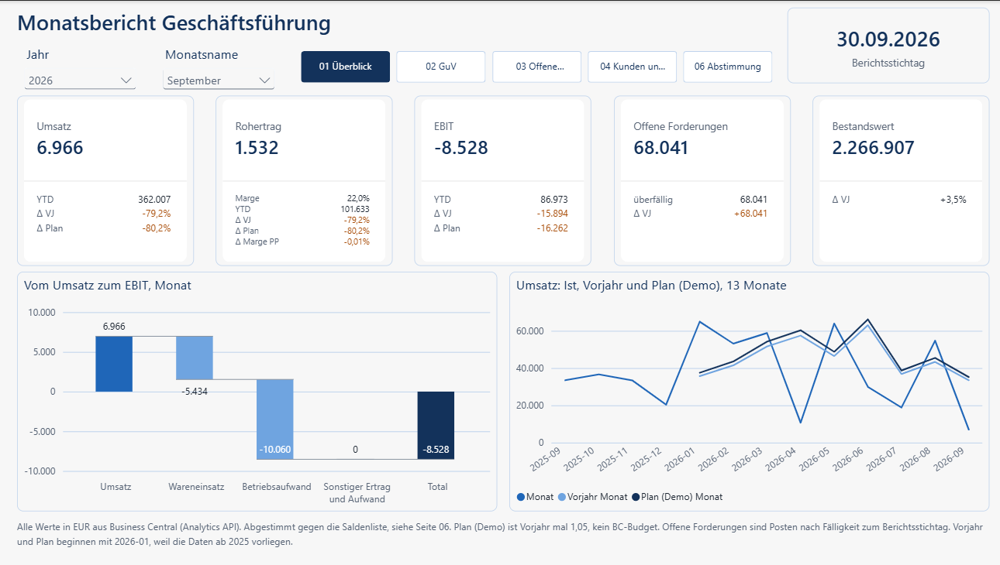
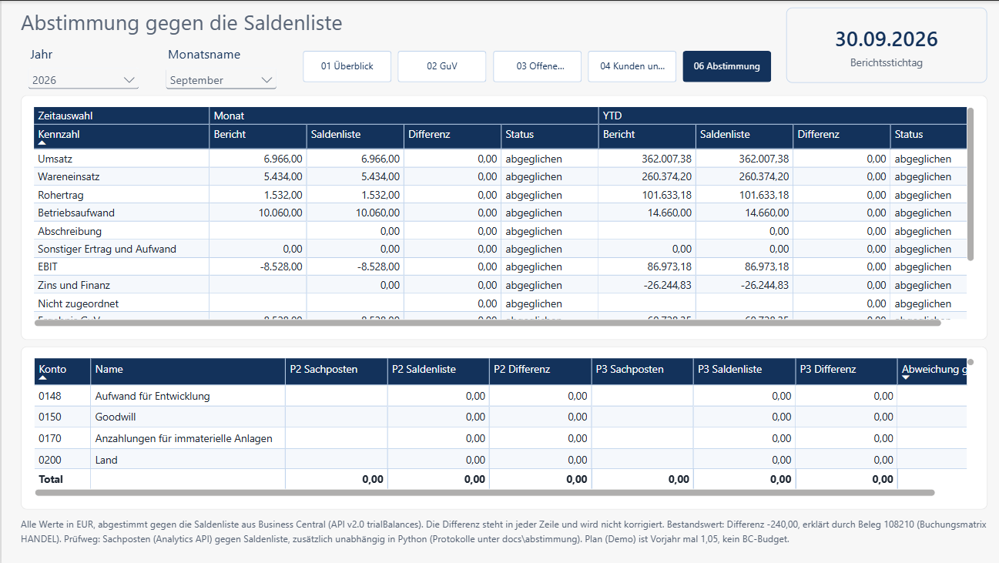
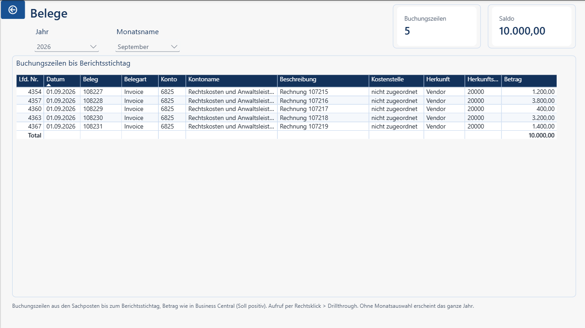
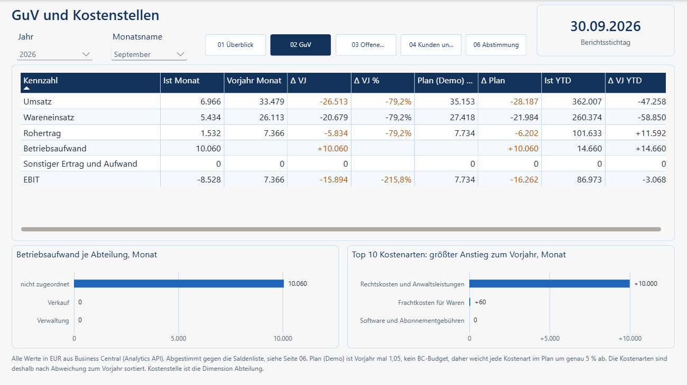
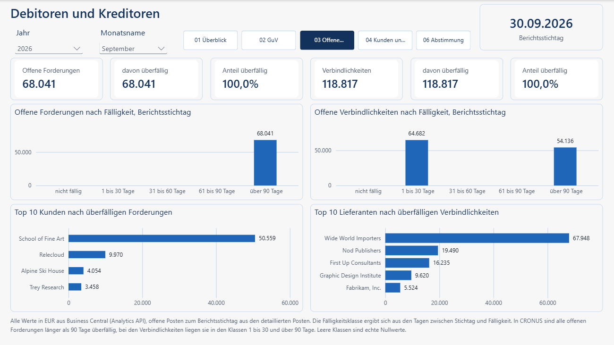
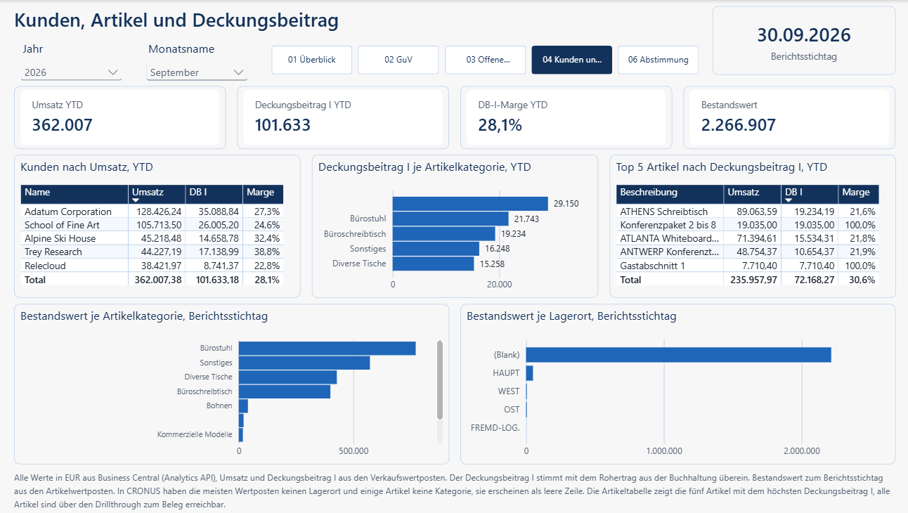
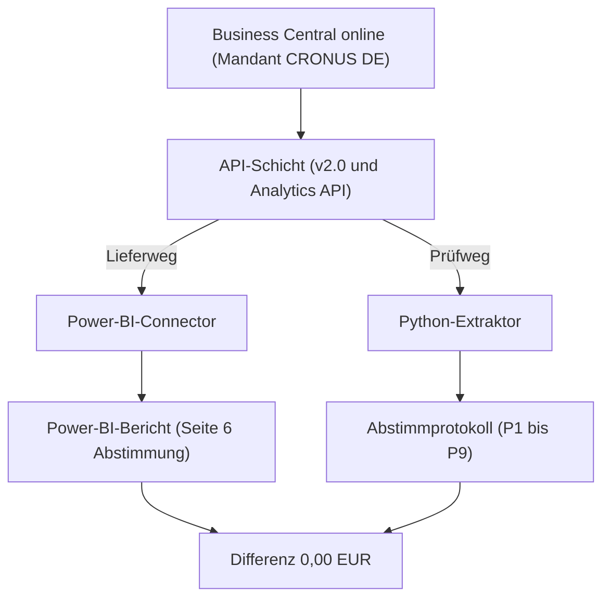
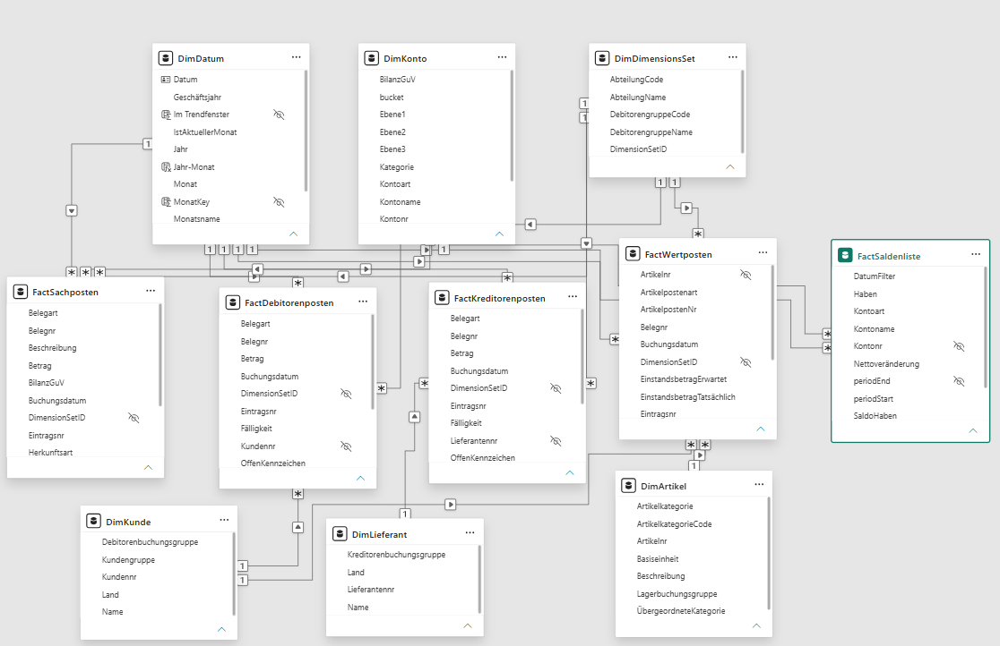

# Monatsreporting aus Business Central

Stand 12.11.2026. Berichtsmonat September 2026. Stichtag 30.09.2026. Snapshot 24.10.2026.

## 1. Einzeiler und drei Screenshots

Monatsreporting aus Business Central online, abgestimmt gegen die Saldenliste, Differenz 0,00 EUR auf Kontenebene.







## 2. Ausgangslage

Zahlen im Reporting stimmen oft nicht mit der Buchhaltung überein. Nach dem Umstieg auf Business Central online soll das Reporting auf einer von Microsoft unterstützten Anbindung laufen.

## 3. Ergebnis

Beträge in EUR. Offene Forderungen und Bestandswert gelten zum Stichtag. Die Marge ist Rohertrag geteilt durch Umsatz, auf eine Nachkommastelle gerundet.

| Kennzahl | Monat bzw. Stichtag | YTD | Differenz zur Saldenliste |
| --- | --- | --- | --- |
| Umsatz | 6.966,00 | 362.007,38 | 0,00 |
| Rohertrag | 1.532,00, Marge 22,0 % | 101.633,18, Marge 28,1 % | 0,00 |
| EBIT | -8.528,00 | 86.973,18 | 0,00 |
| Offene Forderungen | 68.041,07 |  | 0,00 |
| Bestandswert | 2.266.906,50 |  | -240,00, erklärt |

Der Bericht hat sechs Seiten: 01 Überblick, 02 GuV, 03 Offene Posten, 04 Kunden und Artikel, 05 Beleg (Drillthrough, ausgeblendet) und 06 Abstimmung. Der Drillthrough reicht bis zum Beleg, auf Seite 02 von den Rechtskosten im September auf 5 Buchungszeilen mit 10.000,00 EUR. Jede Kennzahl hat genau eine Definition. Das Modell hat 87 Measures.







## 4. Architektur



Architektur: [Architektur](docs/00_architektur.md).

Der Power-BI-Connector liest Business Central online über v2.0 und die Analytics API. Hier ist er der Lieferweg, Sternschema in Power Query und Import-Modus, weil er ohne eigene Infrastruktur auskommt, von Microsoft unterstützt wird und dem entspricht, was ein Mittelständler nach dem Umstieg auf Business Central online betreibt. Die direkte API liest denselben Bestand aus Python und ist hier der Prüfweg, weil sie testbare Snapshots und das Abstimmprotokoll liefert. Eine SQL-Server-Schicht baut dieses Projekt nicht auf. bc2adls wird nicht genutzt, weil es ein nicht unterstütztes Code-Sample von Microsoft ist und Extension, Azure-Ressourcen und Kosten braucht.

Eine eigene API-Seite wäre nötig, wenn eine benötigte Entität weder über v2.0 noch über die Analytics API verfügbar wäre. In diesem Bestand ist das nicht der Fall, deshalb wird keine gebaut.

### Gateway

Die Verbindung zu Business Central online braucht kein Gateway, weil es eine Cloudquelle ist. In diesem Demo-Modell liest DimKonto zusätzlich config/kpi_mapping.csv von der lokalen Platte (pRepoPfad). Für eine geplante Aktualisierung im Power BI Service gehört dieses Mapping in eine Cloudablage oder als Tabelle ins Modell, sonst zieht die lokale Datei ein Gateway nach sich.

### Entscheidungen und Alternativen

| Entscheidung | Alternative | Begründung |
| --- | --- | --- |
| Vorjahr aus den Sachposten | Vorjahr aus der Saldenliste | Die Saldenliste hat 15 Zeiträume: Jahresanker 01.01.2024 bis 31.12.2024 und 14 Monatsenden vom 31.08.2025 bis 30.09.2026. Kalendermonate vor August 2025 fehlen. |
| Plan (Demo) = Vorjahr mal 1,05 | Budget aus Business Central | Ein Budget ist nicht vorhanden (0 Zeilen). Der Demo-Plan verschiebt jede Kostenart um genau 5 %. |
| Belegnummer aus v2.0 generalLedgerEntries über die Eintragsnummer | Belegnummer aus den Analytics-Sachposten | Die Analytics-Sachposten liefern keine Belegnummer. 4.384 von 4.384 Posten sind verknüpft. |
| GuV-Matrix in voller Breite | Schmalere Matrix, 60 % links | Die Matrix hat acht Wertspalten. |
| Top 10 Kostenarten nach Abweichung zum Vorjahr | Rang nach Abweichung zum Plan | Der Demo-Plan verschiebt jede Kostenart um genau 5 %. |
| Top 5 Artikel | Top 10 Artikel | Platz auf der Seite. Alle Artikel über den Drillthrough. |
| Kein Visual nach Fälligkeitsmonat | Aufteilung nach Fälligkeitsmonat | Alle offenen Forderungen sind über 90 Tage überfällig. |
| Seite 05 ausgeblendet | Seite 05 im Navigator | Drillthrough mit eigenen Slicern, Keep all filters aus. |
| Keine Kostenstellensicht, Abteilung nur als Aufriss im Betriebsaufwand | Kostenstelle als eigene Sicht | Umsatz und Wareneinsatz sind zu 100 % ohne Abteilung gebucht. Die Abteilung bleibt ein Aufriss im Betriebsaufwand, mit dem Ausweis nicht zugeordnet. |
| Kein SQL Server, kein bc2adls, keine eigene API-Seite | SQL-Server-Schicht, bc2adls oder eigene API-Seite | Der Connector kommt ohne eigene Infrastruktur aus. Jede benötigte Entität liegt in v2.0 oder in der Analytics API. bc2adls ist nicht unterstützt. |

## 5. Datenmodell



Geladene Tabellen. Quelle und Schlüssel stehen in den Kommentarköpfen der Abfragen. Eine Abfrage FactBudget gibt es nicht. Ein Budget ist nicht vorhanden, der Demo-Plan ist ein Measure.

| Tabelle | Quelle | Schlüssel | Zeilen |
| --- | --- | --- | --- |
| DimDatum | generiert, kein API-Abruf | Datum | 1.461 |
| DimKonto | microsoft/analytics/v1.0, generalLedgerAccounts und generalLedgerAccountCategories, dazu config/kpi_mapping.csv | Kontonr (accountNo) | 221 |
| DimDimensionsSet | microsoft/analytics/v1.0, dynamicDimensions | DimensionSetID | 37 |
| DimKunde | microsoft/analytics/v1.0, customers | Kundennr (customerNo) | 5 |
| DimLieferant | microsoft/analytics/v1.0, vendors | Lieferantennr (vendorNo) | 8 |
| DimArtikel | microsoft/analytics/v1.0, items und itemCategories | Artikelnr (itemNo) | 80 |
| FactSachposten | microsoft/analytics/v1.0, incomeStatementGeneralLedgerEntries und balanceSheetGeneralLedgerEntries, Belegnr aus v2.0 generalLedgerEntries | Eintragsnr (entryNo) | 4.384 |
| FactDebitorenposten | microsoft/analytics/v1.0, customerLedgerEntries | Eintragsnr (dcleEntryNo) | 1.145 |
| FactKreditorenposten | microsoft/analytics/v1.0, vendorLedgerEntries | Eintragsnr (dvleEntryNo) | 869 |
| FactWertposten | microsoft/analytics/v1.0, salesValueEntries vereinigt mit itemValueEntries | Eintragsnr (entryNo) | 878 |
| FactSaldenliste | v2.0, trialBalances | Kontonr und periodEnd | 3.315 |

Regeln zu Vorzeichen, Buckets und Kennzahlen: [Datenmodell](docs/02_datenmodell.md).

## 6. Kennzahlen und Abstimmquellen

| Kennzahl | Definition | Abstimmquelle | Prüfung |
| --- | --- | --- | --- |
| Umsatz | Umsatz ist minus die Nettobewegung des Buckets UMSATZ, Erlösminderungen 4730 und 4770 bleiben darin, Konto 4201 nicht. | Saldenliste | P4 |
| Rohertrag | Rohertrag ist Umsatz minus Wareneinsatz. | Überleitung, Sachposten gegen Saldenliste | Überleitung |
| EBIT | EBIT ist Umsatz minus Wareneinsatz minus Betriebsaufwand minus Abschreibung plus sonstiger Ertrag und Aufwand. | Saldenliste | P5 |
| Offene Forderungen | Offene Forderungen sind die Summe der Debitorenposten in Landeswährung bis zum Stichtag, offen ab 0,01. | Saldo der Forderungskonten | P6 |
| Bestandswert | Bestandswert ist die Summe costAmountActual der Artikelwertposten mit Buchungsdatum bis zum Stichtag. | Saldo der Lagerkonten | P8 |

Sammelkonten, verifiziert aus der BC-Einrichtung: Forderungen 1202 und 1203 (Debitorenbuchungsgruppen), Verbindlichkeiten 3301 und 3302 (Kreditorenbuchungsgruppen), Lager 1001, 1101 und 1102 (Lagerbuchung Einrichtung). Prüfkonto 1085 hat den Saldo 0,00. Das Lagerkorrekturkonto der Buchungsmatrix HANDEL ist 5021. Verbindlichkeiten stehen im Bericht positiv.

| Prüfung | Inhalt |
| --- | --- |
| P1 | Summe Soll gleich Summe Haben über alle Sachposten. Ergebnis 0,00. |
| P2 | Bewegung im Monat je Buchungskonto gegen die Änderung der Endsalden. |
| P3 | Saldo zum Stichtag je Buchungskonto gegen die Saldenliste. |
| P4 | Umsatz. |
| P5 | EBIT. Die Überleitung ergibt 0,00. |
| P5b | Wareneinsatz gegen minus costPostedToGL der Verkaufswertposten. |
| P6 | Offene Forderungen gegen 1202 und 1203. |
| P7 | Verbindlichkeiten gegen 3301 und 3302, im Bericht positiv. |
| P8 | Bestandswert gegen 1001, 1101 und 1102. Eine bekannte Differenz bleibt stehen. |
| P9 | Zeilenzahl im Snapshot gegen manifest.json. Summe der absoluten Abweichungen 0. |

[Abstimmprotokoll August 2026](docs/abstimmung/Abstimmprotokoll_2026-08.md). [Abstimmprotokoll September 2026](docs/abstimmung/Abstimmprotokoll_2026-09.md). [Kennzahlen](docs/03_kennzahlen.md).

## 7. Befunde aus der Abstimmung

- Die Differenz beim Bestandswert ist -240,00 EUR, Status erklärt: Beleg 108210, Artikel CC-1000, Buchungsmatrix HANDEL, der Einkauf bleibt auf Konto 1102. Der Betrag wird nicht verrechnet. costAmountActual minus costPostedToGL ist 0,00.
- Auf Konto 4201, Erträge aus Wertpapieren, liegen Kundenzahlungen von 26.244,83 EUR (Soll minus Haben, YTD). Sie stehen im Finanzergebnis und werden nicht in den Umsatz korrigiert.
- Der Betriebsaufwand ist dünn: September 10.060,00 EUR (Rechtskosten 10.000,00, Fracht 60,00), YTD 14.660,00 EUR. Die Abteilung ist überwiegend nicht zugeordnet, beim Betriebsaufwand 63,6 % der Posten (7 von 11) und 71,0 % des Betrags, bei Umsatz und Wareneinsatz jeweils 100,0 %.
- Der Betriebsaufwand im September hat kein Vorjahr.
- Alle offenen Forderungen sind über 90 Tage überfällig. Verbindlichkeiten liegen in den Klassen 1 bis 30 Tage und über 90 Tage. Ein Visual nach Fälligkeitsmonat wurde deshalb gestrichen.
- Deckungsbeitrag I aus den Wertposten, Verkaufsbetrag plus Einstandsbetrag, trifft den Rohertrag aus den Sachposten. September 6.966,00 plus -5.434,00 ergibt 1.532,00, YTD 362.007,38 plus -260.374,20 ergibt 101.633,18.
- 97,7 % des Bestandswerts haben keinen Lagerort, 2.215.302,00 von 2.266.906,50 EUR.
- Artikel ohne Kategorie haben Umsatz YTD 29.149,90 EUR und Einstand 0,00.
- `python -m src.reconcile --month 2025-09` bricht ab, weil die Saldenliste nur 15 Zeiträume hat. Für September 2025 fehlen die Kalendermonate ab Januar, der erste fehlende Stichtag ist der 31.01.2025.
- Die Abweichung zum Vorjahr YTD in der GuV-Matrix hat keine Signalfarbe. Die Abweichung zum Vorjahr in Prozent bei den offenen Forderungen ist leer, weil das Vorjahr 0,00 ist.

Eine Differenz wird dokumentiert, nicht im Code ausgeglichen. Demodaten, keine Aussage über ein echtes Unternehmen.

## 8. Reproduktion

Voraussetzungen: Business Central Trial mit Land Deutschland, Entra-App, Berechtigung D365 READ, Python 3.12, Power BI Desktop. Die Befehle laufen mit der virtuellen Umgebung `.venv` und den Paketen aus `pyproject.toml`.

Die virtuelle Umgebung anlegen und die Pakete installieren: `py -3.12 -m venv .venv` und `.\.venv\Scripts\python -m pip install -e .`.

`.env.example` nach `.env` kopieren und ausfüllen: `BC_TENANT_ID`, `BC_CLIENT_ID`, `BC_CLIENT_SECRET`, `BC_ENVIRONMENT` (Production). Die Datei nicht einchecken. Die Firmen-ID schreibt `.\.venv\Scripts\python -m src.inventory --probe` nach `.env.local`. Der Extrakt liest sie von dort.

Der Stichtag muss gesetzt sein. Ohne `--stichtag` nimmt der Extrakt das Ende des Vormonats. Die Saldenliste kommt mit dem Extrakt, inklusive Jahresanker 01.01.2024 bis 31.12.2024. Fehlt der Anker in einem vorhandenen Snapshot, ist der Sonderfall `.\.venv\Scripts\python -m src.trial_balance --fetch-anchor`. Der Aufruf braucht den Zugang zu Business Central. `--month 2026-09` schreibt das Protokoll für September nach `docs/abstimmung`. Ohne `--month` schreibt das Programm zusätzlich den Vormonat.

```powershell
.\.venv\Scripts\python -m pytest
.\.venv\Scripts\python -m src.extract --stichtag 2026-09-30
.\.venv\Scripts\python -m src.reconcile --month 2026-09
```

Der Snapshot liegt im Repo unter `data/snapshots/2026-10-24`. Die Abstimmung darauf läuft ohne Zugang zu Business Central:

```powershell
.\.venv\Scripts\python -m src.reconcile --snapshot data/snapshots/2026-10-24 --month 2026-09
```

Ein neuer Extrakt legt einen eigenen Ordner zum Lauftag an und ändert diesen Snapshot nicht.

Danach `powerbi/bc-monthly-reporting.pbip` in Power BI Desktop öffnen und die Parameter setzen: `pUmgebung` Production, `pMandant` CRONUS DE, `pStichtag` 30.09.2026, `pRepoPfad` auf den Ordner des Repos. Die Vorlage enthält `C:\git\bc-monthly-reporting`. Datenschutzebenen für Business Central und den Repo-Ordner auf Organizational setzen, sonst blockiert Power BI die Kombination aus Konten und `config/kpi_mapping.csv` in DimKonto.

Einrichtung: [Einrichtung](docs/04_einrichtung.md). Abfragen: [Power-Query-Vorlagen](powerbi/queries/README.md).

## 9. Grenzen und Ausbau

Die Daten sind die Demofirma CRONUS. Der Plan ist abgeleitet, ein Budget in Business Central ist nicht vorhanden. Der Trial läuft ab, der Snapshot bleibt.

Ausbau ist eine SQL-Server-Schicht für größere Mandanten, ein Dataflow mit inkrementeller Aktualisierung und DATEV als zweite Quelle. Fabric nur, wenn der Kunde Fabric hat.

## 10. Lizenz und Kontakt

MIT, siehe [LICENSE](LICENSE). Kontakt: mail@mirza-data.de, [mirza-data.de](https://mirza-data.de).
