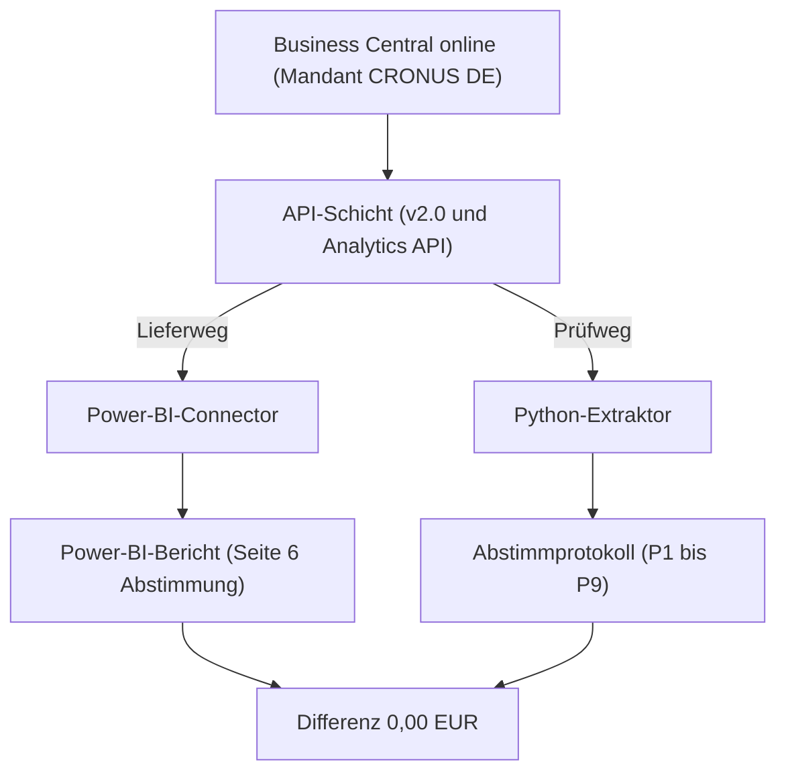

# Architektur

Stand 12.11.2026

## 1. Datenfluss

Der Lieferweg ist der Power-BI-Connector. Er liest v2.0 und die Analytics API, lädt ein Sternschema in Power Query und speichert die Daten im Import-Modus. Er braucht keine eigene Infrastruktur und wird von Microsoft unterstützt.

Der Prüfweg ist Python. Die Anmeldung läuft als Anwendung über Client Credentials, ohne Benutzerkonto. Der Extrakt schreibt den Snapshot, die Abstimmung schreibt das Protokoll.

## 2. Welche API liefert was

Die Liste folgt `config/entities.yaml`. Genutzt heißt: die Entität speist eine Modellabfrage oder den Prüfweg. Alles andere liegt im Snapshot und hat keine eigene Abfrage im Modell.

Die Belegnummer der Sachposten kommt aus v2.0 generalLedgerEntries, über die Eintragsnummer. Die Saldenliste kommt aus v2.0 trialBalances.

DimDimensionsSet liest dynamicDimensions. Diese Entität steht nicht in `config/entities.yaml`. Der Extrakt holt sie zusätzlich. dimensionSetEntries hat 0 Zeilen und wird nicht gelesen.

| Entität | API | Wofür genutzt |
| --- | --- | --- |
| generalLedgerEntries | v2.0 | Belegnummer und Belegart der Sachposten |
| trialBalances | v2.0 | Saldenliste, Abstimmquelle |
| accounts | v2.0 | Snapshot. Das Modell liest die Analytics-Konten |
| dimensions | v2.0 | Snapshot, Dimensionsstamm. Das Modell liest dynamicDimensions |
| dimensionValues | v2.0 | Snapshot |
| customers | v2.0 | Snapshot. Das Modell liest die Analytics-Debitoren |
| vendors | v2.0 | Snapshot. Das Modell liest die Analytics-Kreditoren |
| items | v2.0 | Snapshot. Das Modell liest die Analytics-Artikel |
| itemCategories | v2.0 | Snapshot. Das Modell liest die Analytics-Kategorien |
| incomeStatementGeneralLedgerEntries | Analytics | FactSachposten, GuV |
| balanceSheetGeneralLedgerEntries | Analytics | FactSachposten, Bilanz |
| closingGeneralLedgerEntries | Analytics | Flag Abschlussbuchung. 0 Zeilen |
| customerLedgerEntries | Analytics | FactDebitorenposten |
| vendorLedgerEntries | Analytics | FactKreditorenposten |
| salesValueEntries | Analytics | FactWertposten, Verkaufsteil |
| purchaseValueEntries | Analytics | Snapshot und Prüfweg. Keine Modellabfrage |
| itemValueEntries | Analytics | FactWertposten und Bestandswert |
| itemLedgerEntries | Analytics | Snapshot und Belegbrücke. Keine Modellabfrage |
| generalLedgerAccounts | Analytics | DimKonto |
| generalLedgerAccountCategories | Analytics | DimKonto |
| accountCategories | Analytics | Snapshot. DimKonto liest sie nicht |
| dimensions | Analytics | Snapshot, Shortcut-Dimensionen 1 bis 8. Nicht DimDimensionsSet |
| dimensionSetEntries | Analytics | Nicht gelesen. 0 Zeilen |
| generalLedgerBudgets | Analytics | Snapshot. 0 Zeilen, kein FactBudget |
| generalLedgerBudgetEntries | Analytics | Snapshot. 0 Zeilen |
| customers | Analytics | DimKunde |
| vendors | Analytics | DimLieferant |
| items | Analytics | DimArtikel |
| itemCategories | Analytics | DimArtikel |
| salespersonPurchasers | Analytics | Snapshot. Keine Modellabfrage |
| locations | Analytics | Snapshot. Der Lagerort steht als Spalte an den Wertposten |

## 3. Entscheidung Connector, direkte API, bc2adls

| Weg | Stärken | Schwächen | Rolle in diesem Projekt |
| --- | --- | --- | --- |
| Power-BI-Connector | Von Microsoft unterstützt, keine eigene Infrastruktur, Sternschema in Power Query, Import-Modus | Transformation in Power Query statt in einer SQL-Schicht. Kein Verlauf ohne Dataflow mit inkrementeller Aktualisierung. | Lieferweg |
| Direkte API | Dieselben Entitäten, testbarer Snapshot, Abstimmprotokoll | Anmeldung über eine Entra-App, keine SQL-Server-Schicht | Prüfweg |
| bc2adls | Kopiert Tabellen in einen Data Lake oder nach Fabric | Nicht unterstütztes Code-Sample von Microsoft. Braucht Extension, Azure-Ressourcen und Kosten | Nicht genutzt |

## 4. Wann eine eigene API-Seite nötig wäre

Eine eigene API-Seite wäre nötig, wenn eine benötigte Entität oder ein benötigtes Feld weder in v2.0 noch in der Analytics API läge. In diesem Bestand ist das nicht der Fall. Deshalb wird keine gebaut.

## 5. Gateway

Die Verbindung zu Business Central online braucht kein Gateway, weil es eine Cloudquelle ist. In diesem Demo-Modell liest DimKonto zusätzlich config/kpi_mapping.csv von der lokalen Platte (pRepoPfad).

Cloudquellen brauchen kein Gateway. Führt eine Abfrage eine Cloudquelle mit einer Quelle hinter einem Gateway zusammen, läuft auch die Cloudquelle über das Gateway. Deshalb gehört config/kpi_mapping.csv im Betrieb in eine Cloudablage oder als Tabelle ins Modell.

## 6. Leselast

Berichte für Business Central online, die seit Februar 2022 erstellt wurden, lesen standardmäßig von einer schreibgeschützten Replik der Datenbank. Das entlastet die Hauptdatenbank.

## 7. Quellen

- [Power BI mit Business Central](https://learn.microsoft.com/dynamics365/business-central/admin-powerbi-overview)
- [Connector Dynamics 365 Business Central](https://learn.microsoft.com/power-query/connectors/dynamics-365-business-central)
- [Aktualisieren von Daten in Power BI](https://learn.microsoft.com/power-bi/connect-data/refresh-data)
- [Analytics API](https://learn.microsoft.com/dynamics365/business-central/dev-itpro/api-analytics/api-analytics-overview)
- [Daten aus Business Central lesen](https://learn.microsoft.com/dynamics365/business-central/dev-itpro/developer/devenv-extract-data)

Modell und Kennzahlen: [Datenmodell](02_datenmodell.md), [Kennzahlen](03_kennzahlen.md).
