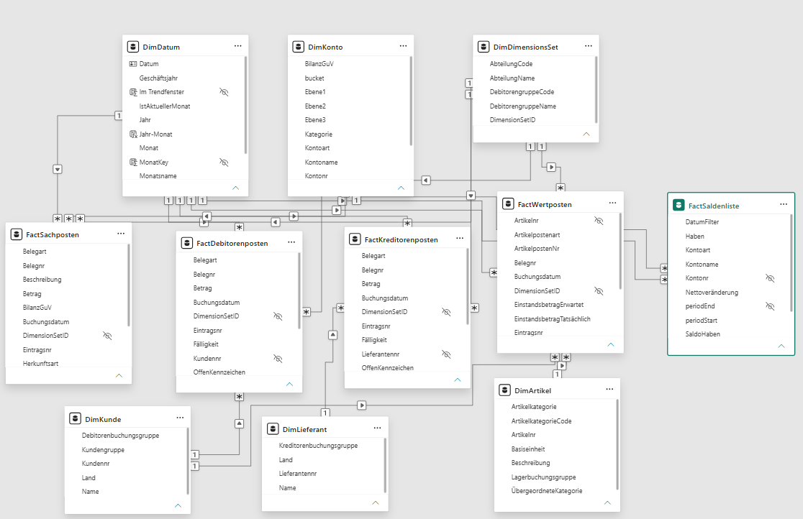

# Datenmodell, Vorzeichen und Kennzahlen

Stand 12.11.2026

## Bild

## Tabellen

Quelle und Schlüssel stehen in den Abfragen der Tabellen. Hilfstabellen sind Zeitauswahl, Abstimmzeile, Bruecke und Faelligkeitsklasse.

Zeitauswahl ist die Berechnungsgruppe. Sie leitet aus jedem Basis-Measure Monat, YTD, Vormonat, Vorjahr und Plan ab.

Abstimmzeile listet die Kennzahlzeilen für GuV und Abstimmung. Ein Measure schaltet darüber je Zeile.

Bruecke hält die fünf Schritte der Ergebnisbrücke, von Umsatz bis sonstiger Ertrag und Aufwand, in fester Reihenfolge.

Faelligkeitsklasse teilt offene Posten in feste Tagesgrenzen. Jede offene Rechnung fällt in genau eine Klasse. Die Grenzen kommen nicht aus Business Central.

pStichtag ist der Parameter für den Berichtsstichtag, Standard 30.09.2026. Die Abfragen filtern damit keine Zeile.

| Tabelle | Art | Quelle | Schlüssel |
| --- | --- | --- | --- |
| DimDatum | Dimension | generiert, kein API-Abruf | Datum |
| DimKonto | Dimension | microsoft/analytics/v1.0, generalLedgerAccounts und generalLedgerAccountCategories, dazu config/kpi_mapping.csv | Kontonr (accountNo) |
| DimDimensionsSet | Dimension | microsoft/analytics/v1.0, dynamicDimensions | DimensionSetID |
| DimKunde | Dimension | microsoft/analytics/v1.0, customers | Kundennr (customerNo) |
| DimLieferant | Dimension | microsoft/analytics/v1.0, vendors | Lieferantennr (vendorNo) |
| DimArtikel | Dimension | microsoft/analytics/v1.0, items und itemCategories | Artikelnr (itemNo) |
| FactSachposten | Fakt | microsoft/analytics/v1.0, incomeStatementGeneralLedgerEntries und balanceSheetGeneralLedgerEntries. Abschlussflag aus closingGeneralLedgerEntries. Belegnr aus v2.0 generalLedgerEntries | Eintragsnr (entryNo) |
| FactDebitorenposten | Fakt | microsoft/analytics/v1.0, customerLedgerEntries | Eintragsnr (dcleEntryNo) |
| FactKreditorenposten | Fakt | microsoft/analytics/v1.0, vendorLedgerEntries | Eintragsnr (dvleEntryNo) |
| FactWertposten | Fakt | microsoft/analytics/v1.0, salesValueEntries vereinigt mit itemValueEntries | Eintragsnr (entryNo) |
| FactSaldenliste | Fakt | v2.0, trialBalances | Kontonr und periodEnd |
| Zeitauswahl | Hilfstabelle | Berechnungsgruppe im Modell | Zeitauswahl |
| Abstimmzeile | Hilfstabelle | berechnete Tabelle im Modell | Kennzahl |
| Bruecke | Hilfstabelle | berechnete Tabelle im Modell | Schritt |
| Faelligkeitsklasse | Hilfstabelle | berechnete Tabelle im Modell, feste Tagesgrenzen | Klasse |
| Kennzahlen | Measure-Tabelle | Measures, keine Entität | keiner |
| pStichtag | Parameter | Parameter Datum | pStichtag |

Eine Abfrage FactBudget gibt es nicht.

## Beziehungen

15 Beziehungen. Alle sind viele zu eins vom Fakt zur Dimension, mit einseitiger Filterrichtung von der Dimension zum Fakt, und aktiv. Das sind die Standardwerte, deshalb stehen sie in relationships.tmdl nicht ausdrücklich. Es gibt keine beidseitigen Filter und keine inaktiven Beziehungen.

| Von | Nach | Kardinalität | Filterrichtung | Aktiv |
| --- | --- | --- | --- | --- |
| FactSachposten.Buchungsdatum | DimDatum.Datum | viele zu eins | Dimension filtert Fakt | ja |
| FactSachposten.Kontonr | DimKonto.Kontonr | viele zu eins | Dimension filtert Fakt | ja |
| FactSachposten.DimensionSetID | DimDimensionsSet.DimensionSetID | viele zu eins | Dimension filtert Fakt | ja |
| FactDebitorenposten.Buchungsdatum | DimDatum.Datum | viele zu eins | Dimension filtert Fakt | ja |
| FactDebitorenposten.Kundennr | DimKunde.Kundennr | viele zu eins | Dimension filtert Fakt | ja |
| FactDebitorenposten.DimensionSetID | DimDimensionsSet.DimensionSetID | viele zu eins | Dimension filtert Fakt | ja |
| FactKreditorenposten.Buchungsdatum | DimDatum.Datum | viele zu eins | Dimension filtert Fakt | ja |
| FactKreditorenposten.Lieferantennr | DimLieferant.Lieferantennr | viele zu eins | Dimension filtert Fakt | ja |
| FactKreditorenposten.DimensionSetID | DimDimensionsSet.DimensionSetID | viele zu eins | Dimension filtert Fakt | ja |
| FactWertposten.Buchungsdatum | DimDatum.Datum | viele zu eins | Dimension filtert Fakt | ja |
| FactWertposten.Artikelnr | DimArtikel.Artikelnr | viele zu eins | Dimension filtert Fakt | ja |
| FactWertposten.Kundennr | DimKunde.Kundennr | viele zu eins | Dimension filtert Fakt | ja |
| FactWertposten.DimensionSetID | DimDimensionsSet.DimensionSetID | viele zu eins | Dimension filtert Fakt | ja |
| FactSaldenliste.periodEnd | DimDatum.Datum | viele zu eins | Dimension filtert Fakt | ja |
| FactSaldenliste.Kontonr | DimKonto.Kontonr | viele zu eins | Dimension filtert Fakt | ja |

## Measures

87 Measures, alle in der Tabelle Kennzahlen. Gezählt nach Anzeigeordner. Kein DAX-Abdruck.

| Anzeigeordner | Anzahl |
| --- | ---: |
| 01 Basis | 22 |
| 03 Abweichung | 1 |
| 04 Forderungen | 2 |
| 06 Abstimmung | 13 |
| 07 Karten | 24 |
| 08 GuV Seite 2 | 12 |
| 09 Debitoren Kreditoren Seite 3 | 4 |
| 10 Kunden Artikel Seite 4 | 7 |
| 11 Beleg Seite 5 | 2 |
| Summe | 87 |

## Datumsformat

FactSachposten[Buchungsdatum] und DimDatum[Datum] haben das Format dd.mm.yyyy.

Snapshot `data/snapshots/2026-10-24`, Firma CRONUS DE, Umgebung Production, Stichtag 30.09.2026.

Dieser Abschnitt hält die Regeln fest, mit denen das Abstimmprotokoll rechnet. Das Sternschema steht im Abschnitt Tabellen. Die Zuordnung in `config\kpi_mapping.csv` ist am 24.10.2026 von Mirza bestätigt. Es gibt dafür keine eigene Spalte.

## Periodenregel

Der Periodenwert kommt aus den Endsalden der Saldenliste.

- Monat = Endsaldo zum Monatsende minus Endsaldo zum Vormonatsende.
- YTD = Endsaldo zum Stichtag minus Endsaldo zum 31.12. des Vorjahres.

Für September 2026 ist der YTD-Anker der 31.12.2025. Der Jahresanker 01.01.2024 bis 31.12.2024 liegt in derselben Saldenliste und trägt die YTD-Rechnung der Monate 2025.

GuV-Salden sind kumuliert, weil keine Abschlussbuchungen die Konten auf null setzen. `closingGeneralLedgerEntries` hat 0 Zeilen. Ein GuV-Saldo ist deshalb kein Periodenwert. Die Bewegung eines Monats ist die Differenz zweier Endsalden.

Konto 5021 wird als Nettobewegung gelesen, Soll minus Haben, auf beiden Wegen. Die Saldenliste liefert dafür die Differenz der Endsalden. Die Zerlegung in Wareneinsatz und Lagerzugang kommt aus den Artikelwertposten und wird auf beiden Wegen gleich angesetzt. P5 vergleicht damit weiter Sachposten gegen Saldenliste. P5b prüft den Wareneinsatz unabhängig gegen die Verkaufswertposten.

Jede Kennzahl hat zwei Wege. Weg (a) summiert die Sachposten bis zum Stichtag. Weg (b) liest die Saldenliste. Die Differenz ist das Prüfergebnis. Toleranz 0,00.

`amount` = `debitAmount` minus `creditAmount`. Posten nach dem Stichtag des Protokolls gehen in keinen Periodenwert. Im Snapshot vom 24.10.2026 sind das 48 Posten vom 01.10.2026 bis zum 01.09.2027.

## Vorzeichenregeln

Der Berichtswert ist Vorzeichen mal Basis.

- Regel NETTO: Basis = Soll minus Haben.
- Regel NUR_SOLL: Basis = Soll.
- Regel NUR_HABEN: Basis = Haben.

Vorzeichen -1 haben UMSATZ, SONSTIGER_ERTRAG_AUFWAND, ZINS_FINANZ, STEUER und NICHT_ZUGEORDNET. Eine Habenbuchung auf einem Erlöskonto wird im Bericht positiv. Vorzeichen +1 haben WARENEINSATZ, LAGERZUGANG_VERRECHNUNG, BETRIEBSAUFWAND und ABSCHREIBUNG. Aufwand bleibt positiv. Die Lagerzugangsverrechnung steht im Bericht positiv und wird dem EBIT nicht zugeschlagen.

Der Einstandsbetrag der Verkaufswertposten ist negativ. Der Wareneinsatz im Bericht ist positiv.

Geprüft an je einem Posten mit Betrag. Postennummer aus v2.0 `entryNumber`.

| Bucket | Posten | Konto | Datum | Soll | Haben | amount | Bericht |
| --- | --- | --- | --- | --- | --- | --- | --- |
| UMSATZ | 1710 | 4403 | 13.01.2025 | 0,00 | 165,60 | -165,60 | 165,60 |
| WARENEINSATZ | 1699 | 5021 | 01.04.2026 | 148,90 | 0,00 | 148,90 | 148,90 |
| LAGERZUGANG_VERRECHNUNG | Wertposten | 5021 | 01.06.2025 | 0,00 | 392.300,00 | -392.300,00 | 392.300,00 |
| BETRIEBSAUFWAND | 4376 | 6740 | 01.09.2026 | 60,00 | 0,00 | 60,00 | 60,00 |
| ABSCHREIBUNG | 86 | 6220 | 31.12.2024 | 13.000,00 | 0,00 | 13.000,00 | 13.000,00 |

Posten 1710, Konto 4403, Beleg 103001, Regel NETTO, Vorzeichen -1. Bericht = -1 mal -165,60 = 165,60.

Posten 1699, Konto 5021, Beleg 108001, Regel NETTO, Vorzeichen +1. Bericht des einzelnen Postens = 148,90. Derselbe Beleg hat am selben Tag ein Haben 148,90, das Paar ist in der Nettobewegung 0,00.

Posten 2, Konto 5021, Beleg STANDARD, 01.06.2025, Haben 392.300,00. Er gehört zu den Artikelwertposten Positive Adjmt. Im Bericht steht der Lagerzugang positiv. Die Formel zieht denselben Betrag mit Habenvorzeichen von der Nettobewegung ab.

Posten 4376, Konto 6740, Beleg 108232, Regel NETTO, Vorzeichen +1. Bericht = 60,00.

Posten 86, Konto 6220, Beleg ASSET-DEPR1, Regel NETTO, Vorzeichen +1. Bericht = 13.000,00.

ZINS_FINANZ hat Bewegung auf 4201. SONSTIGER_ERTRAG_AUFWAND, STEUER und NICHT_ZUGEORDNET haben die Regel, aber keinen Posten mit Betrag in Landeswährung. Konto 4840 hat Posten, Soll und Haben in Landeswährung sind 0,00. Konto 4203 und Konto 7400 haben keine Bewegung. Ein Steuerkonto mit der Regel STEUER ist nicht belegt. Ein GuV-Konto mit Bewegung ohne Zeile in der Zuordnung gibt es nicht.

## Buckets

Summen- und Überschriftenkonten sind ausgeschlossen. Jedes GuV-Buchungskonto mit Bewegung hat eine Zeile. Konto 5021 hat eine Zeile, WARENEINSATZ, NETTO. Die Bemerkung in der Zuordnung beschreibt die Zerlegung.

| Bucket | Inhalt | Regel | Vorzeichen |
| --- | --- | --- | --- |
| UMSATZ | Kategorie Income, inklusive Erlösminderungen 4730 und 4770. 4201 liegt nicht hier | NETTO | -1 |
| WARENEINSATZ | Kategorie Wareneinsatz. 5021 ist die Nettobewegung minus Lagerzugang | NETTO | +1 |
| LAGERZUGANG_VERRECHNUNG | costPostedToGL der Artikelwertposten mit Artikelpostenart Positive Adjmt. oder Output, im Bericht positiv | keine Kontenzeile | +1 |
| BETRIEBSAUFWAND | Kategorie Aufwand, soweit unten nicht anders genannt | NETTO | +1 |
| ABSCHREIBUNG | Kontoname enthält Abschreibung. BC hat keinen eigenen Knoten, die Unterkategorie ist Ausgaben | NETTO | +1 |
| SONSTIGER_ERTRAG_AUFWAND | Währung, Gewinne und Verluste, Sonstiges, Einkaufsrabatte, dazu 7400 | NETTO | -1 |
| ZINS_FINANZ | 4201 nach Kontozweck, dazu 4203. 4201 hat Kundenzahlungen, 4203 keine Bewegung | NETTO | -1 |
| STEUER | Steueraufwand im Namen oder im Kategorieknoten | NETTO | -1 |
| NICHT_ZUGEORDNET | GuV-Konto mit Bewegung ohne Zeile in der Zuordnung | NETTO | -1 |

Konto 4201 heißt Erträge aus Wertpapieren. Die Hierarchie ist Einnahmen, nicht der Zinsknoten. Die Entscheidung vom 24.10.2026 legt es nach dem Kontozweck ins Finanzergebnis. Auf dem Konto liegen Kundenzahlungen. Das ist eine Fehlbuchung der Demodaten und wird nicht im Umsatz korrigiert. Konto 6740 Fracht liegt in BC unter Aufwand, nicht unter Wareneinsatz, und bleibt Betriebsaufwand. Konto 60410 hat keine Unterkategorie, der Name ist Versorgungsaufwand, der Bucket ist Betriebsaufwand. Konto 7400 heißt in BC Fällige Rechnungen, Rundung. Rundung ist kein Finanzergebnis und liegt im sonstigen Ertrag und Aufwand, Vorzeichen -1. Konten 5032 bis 5037 sind Abweichungskonten, der Bucket bleibt WARENEINSATZ. Bewegung laut AP-01 keine, im Snapshot ebenfalls keine.

## Kennzahlen

UMSATZ = minus Summe der Bewegung im Bucket UMSATZ.

WARENEINSATZ = Nettobewegung der Wareneinsatzkonten minus LAGERZUGANG_VERRECHNUNG.

LAGERZUGANG_VERRECHNUNG = Summe `costPostedToGL` der Artikelwertposten, deren Artikelposten die Art Positive Adjmt. hat, und weiterer Zugänge ohne Einkaufsrechnung wie Output, falls vorhanden. Buchungsdatum der Periode. Vorzeichen wie die Habenseite auf 5021, also minus `costPostedToGL`, wenn der Zugang im Haben steht. Im Bericht steht der Betrag positiv.

P5b. WARENEINSATZ aus der FiBu gleich minus Summe `costPostedToGL` der Verkaufswertposten. Je Monat und YTD, für 2025 und 2026. Toleranz 0,00. Differenzen werden gelistet.

ROHERTRAG = UMSATZ minus WARENEINSATZ. Die Zeile steht in der Überleitung und wird nicht noch einmal addiert.

EBIT = UMSATZ plus SONSTIGER_ERTRAG_AUFWAND minus WARENEINSATZ minus BETRIEBSAUFWAND minus ABSCHREIBUNG.

P5. Das vorzeichenrichtige Ergebnis aller GuV-Konten ist EBIT plus ZINS_FINANZ plus STEUER plus LAGERZUGANG_VERRECHNUNG plus NICHT_ZUGEORDNET. Das GuV-Ergebnis ist minus die Nettosumme der zugeordneten GuV-Konten. Konto 5021 geht dort einmal als Nettobewegung ein. Die Differenz der Überleitung ist 0,00, auf der Sachpostenseite und auf der Saldenlistenseite. Die Zeile "davon Fehlbuchung Kundenzahlungen auf 4201" ist ein Teil von Zins und Finanz und wird nicht noch einmal addiert.

P6. Offene Forderungen sind die Summe `dcleAmountLCY` je `cleEntryNo` mit `dclePostingDate` bis zum Stichtag. Offen ab 0,01. Gegenkonto ist der Saldo von 1202 plus 1203. Quelle und Status: verifiziert (BC-Einrichtung), Debitorenbuchungsgruppen.

P7. Offene Kreditorenposten analog mit `dvleAmountLCY`. Gegenkonto ist der Saldo von 3301 plus 3302. Im Bericht steht der Betrag positiv. Quelle und Status: verifiziert (BC-Einrichtung), Kreditorenbuchungsgruppen.

P8. Bestandswert ist die Summe `costAmountActual` der Artikelwertposten mit Buchungsdatum bis zum Stichtag. Gegenkonto ist der Saldo von 1001 plus 1101 plus 1102. Quelle und Status: verifiziert (BC-Einrichtung), Lagerbuchung Einrichtung. Das Lagerkorrekturkonto der Buchungsmatrix HANDEL ist 5021. Prüfkonto 1085 hat den erwarteten Saldo 0,00. `costAmountActual` minus `costPostedToGL` ist der Hinweis auf nicht gebuchte Lagerregulierung. Eine bekannte Differenz bleibt stehen. Stimmt der Betrag exakt mit `bekannte_differenzen`, ist der Status erklärt. Weicht er ab, ist der Status Differenz. Die Toleranz ist 0,00. Der Betrag wird nicht verrechnet.

P9. Zeilenzahl im Snapshot gegen `manifest.json`. Die Spalte Modell ist leer.

## Entscheidungen 24.10.2026

Berichtsmonat ist September 2026. Das Vorjahr wird gezeigt.

4201 liegt im Finanzergebnis, Vorzeichen -1. Die Zuordnung folgt dem Kontozweck. Auf dem Konto liegen Kundenzahlungen (Belegart Payment, FIBUBUCHBL). Das ist eine Fehlbuchung der Demodaten, Befund b. Sie wird nicht im Umsatz korrigiert. 7400 liegt im sonstigen Ertrag und Aufwand, Vorzeichen -1. Rundung ist kein Finanzergebnis. Die übrigen Zeilen der Zuordnung sind bestätigt. 4730 und 4770 bleiben als Erlösminderung im Umsatz.

Keine Kostenstellen-Sicht. Umsatz und Wareneinsatz sind zu 100 % ohne Abteilung gebucht. Die Debitorengruppe (87,2 % der GuV-Posten) ist der Filter für den Umsatz. Die Abteilung ist nur ein Drilldown im Betriebsaufwand, mit dem Ausweis "nicht zugeordnet".

Budget: ein G/L-Budget ist nicht vorhanden. Der abgeleitete Demo-Plan ist ein Measure im Modell und wird im Bericht als Demo-Plan gekennzeichnet.

Das Geschäftsjahr ist das Kalenderjahr. `dateSetup` ist nicht im Katalog.

Filterfelder `dclePostingDate`, `dvlePostingDate` und `budgetDate` sind bestätigt.

## Belegbrücke

Artikelposten und Wertposten tragen nicht dieselbe Belegnummer wie FiBu, Debitoren und Kreditoren. Ein eigenes Rechnungsnummernfeld neben `documentNo` gibt es an Verkaufswertposten, Einkaufswertposten und Artikelposten nicht. `salesInvHeaderDocumentNo` und `purchInvHeaderDocumentNo` sind die gebuchte Rechnung, dieselbe Nummernserie wie der Sachposten.

Verkauf. Der Artikelposten hat `documentNo` 102. Der Verkaufswertposten hat `documentNo` 103. Das ist die Nummer in FiBu und Debitorenposten. Der Schlüssel zum Artikelposten ist `itemLedgerEntryNo`.

Beispiel, 13.01.2025, Artikel 1928-S. Artikelposten 312, Beleg 102001, Art Sale. Verkaufswertposten 314, `itemLedgerEntryNo` 312, Beleg 103001. Debitorenposten Beleg 103001, `salesInvHeaderDocumentNo` 103001, Debitor 20000.

Abdeckung im Snapshot vom 24.10.2026. 532 von 532 Verkaufswertposten treffen einen Artikelposten (100 %). 296 von 296 Belegen der Verkaufswertposten stehen in den Debitorenposten (100 %). Die Belegnummer 102 der Artikelposten kommt in den Verkaufswertposten nicht vor (0 %).

Einkauf. Artikelposten und Wareneingänge führen 107. Einkaufsrechnungen in den Einkaufswertposten, in der FiBu und in den Kreditorenposten führen 108. Schlüssel wieder `itemLedgerEntryNo`, danach `documentNo` der Rechnung.

Beispiel. Einkaufswertposten 66, Beleg 108001, `itemLedgerEntryNo` 66, Artikel 1896-S. Artikelposten 66, Beleg 107007, Art Purchase, Belegart Purchase Receipt. Kreditorenposten Beleg 108001, `purchInvHeaderDocumentNo` 108001.

Abdeckung. 285 von 285 Einkaufswertposten treffen einen Artikelposten (100 %). 261 von 261 Rechnungszeilen mit Beleg 108 stehen in den Kreditorenposten (100 %, 226 Belege). 24 Zeilen mit Beleg 107 sind Wareneingänge und stehen nicht in den Kreditorenposten (0 %).

Drillthrough. Artikelposten `entryNo` gleich Wertposten `itemLedgerEntryNo`. Dessen `documentNo` (103 oder 108) gleich `dcleDocumentNo` beziehungsweise `dvleDocumentNo`. Die Belegnummer des Artikelpostens hängt nicht direkt an der FiBu.

## Hinweise zum Modell

Ein Measure darf nicht in einem einfachen Boolean-Filter stehen. In Bewegung Sachposten und Lagerzugang Verrechnung steht der Stichtag deshalb als KEEPFILTERS über einen Filter auf DimDatum[Datum].

Konten ohne Posten im Monatsfilter können in einer Tabelle fehlen. showAll ist auf der Tabelle nicht gesetzt.
